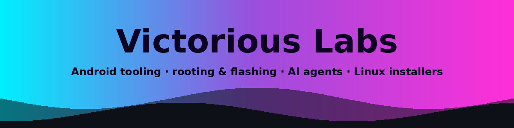

## ⚡ About

- **Android & Termux tooling** — modules, rootfs work, and on-device apps around Magisk/KernelSU and Linux-on-Android.
- **AI agent hubs** — Kotlin/Android agents with fleet IPC to Termux and security companions.
- **Device recovery & installers** — flashing/root workflows and cross-platform Pi Zero tooling.
- **Security labs & experiments** — KYC test labs, swarm-style pentest agents, file managers, and retro multiplayer.

## 🟣 Featured projects

| Project | Description |
|:--------|:------------|
| [**droidcommand-AI**](https://github.com/Victorious93/droidcommand-AI) | Android AI agent hub: JVM-tested tool engine, Forge builds, and fleet IPC to Termux/security companions. |
| [**rootforge-os**](https://github.com/Victorious93/rootforge-os) | Debian live distro + Termux rootfs toolkit for Magisk/KernelSU module and boot-image work. |
| [**VictorLink64**](https://github.com/Victorious93/VictorLink64) | Android app for N64 & Super Nintendo play, built-in chess, and local/online multiplayer (PLAY · CONNECT · CAST). |
| [**BakerPi-Installer**](https://github.com/Victorious93/BakerPi-Installer) | Cross-platform tool installer for Pi Zero 1.3 — browser/native UI over USB OTG or SSH. |
| [**MT-Manager-VIP**](https://github.com/Victorious93/MT-Manager-VIP) *(FileForge)* | FileForge: clean-room Android file manager skeleton (Compose) — M0, dual-pane planned. |
| [**Pentest-Swarm-AI**](https://github.com/Victorious93/Pentest-Swarm-AI) *(fork)* | AGPL fork of Armur Pentest Swarm AI with Android companion APK for the DroidCommand fleet. |
| [**HackerAI**](https://github.com/Victorious93/hackeraiETC) *(fork · hackeraiETC)* | AI-powered penetration testing assistant — "find and fix vulnerabilities by chatting with AI"; companion app in the DroidCommand fleet. |

### 🔒 Private work in progress

| Project | Description |
|:--------|:------------|
| **Victorious File Manager** | Standalone Android file manager (Kotlin + Compose): dual panes, tabs, copy/move/delete/rename queue with undo, search, bookmarks, trash. |
| **VictorSuite** | Termux-based Android Linux suite: proot containers, backup/restore, plugins, X11, and automation tools. |
| **Victorious Flash** | Download, verify and flash Linux ISOs to USB (Tauri v2). |
| **EDL-Commander** | Safety-first Rust framework for Qualcomm EDL recovery — Phase 1 Sahara core + simulator (no USB yet). |
| **KYC-AuditLab** | IdentityShield: local-first KYC security test lab against a bundled simulator (Phase 1). |
| **Victorious Keyboard** | Android IME based on FlorisBoard: encrypted clipboard, developer row, snippets, offline dictionary packs. |

## 🔷 Tech stack

  
  
  
  
  
  
  
  
  
  

## 📊 Stats

See my activity at **[github.com/Victorious93](https://github.com/Victorious93)**.

<b>GitHub stats</b> (live cards — may not render in the GitHub mobile app)

 

  
  

  

*Victorious Labs — tools for Android, Linux, and agent-driven workflows.*

