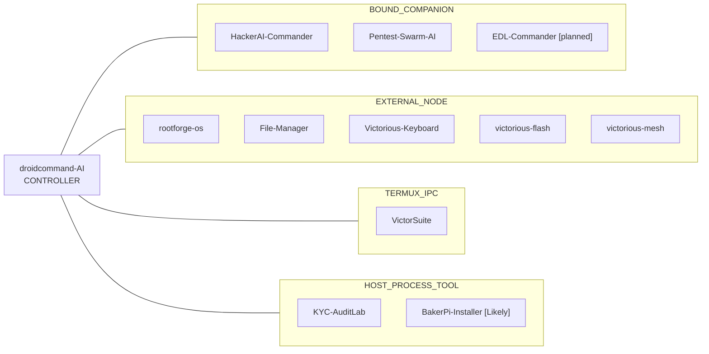

## ⚡ About

- **Android & Termux tooling** — modules, rootfs work, and on-device apps around Magisk/KernelSU and Linux-on-Android.
- **AI agent hubs** — a phone-side command center with a small fleet of companion apps and tools.
- **Device recovery & installers** — flashing/root workflows and cross-platform Pi Zero tooling.
- **Security labs & experiments** — KYC test labs, swarm-style pentest agents, file managers, and retro multiplayer.

## 🟣 The fleet

[**droidcommand-AI**](https://github.com/Victorious93/droidcommand-AI) is the **controller** — the hub I talk to. The other apps are members, grouped by how they connect (not by topic). This is a map, not a claim that every link is live.

Public repos are linked. Names without a link are **not a public repo** on this account from here (they may still be private or not created yet). VictorLink64 is a separate project — **not** in this fleet.

### Controller (hub)

The app at the center. Members hang off this; they are not folded into it.

- [**droidcommand-AI**](https://github.com/Victorious93/droidcommand-AI) — on-device AI command center: chat, tools, and the place the fleet is reached from.

### BOUND_COMPANION

Tightly bound apps signed with the shared key.

- [**HackerAI-Commander**](https://github.com/Victorious93/HackerAI-Commander) — chat with AI to find and fix security issues; companion in this fleet.
- [**Pentest-Swarm-AI**](https://github.com/Victorious93/Pentest-Swarm-AI) — swarm of specialist agents for authorized pentest work (AGPL fork with an Android companion).
- **EDL-Commander** *[planned]* — Qualcomm EDL recovery helper (Sahara-first, safety-minded). No public repo here yet.

### EXTERNAL_NODE

Separate apps that talk over a small JSON command bridge.

- [**rootforge-os**](https://github.com/Victorious93/rootforge-os) — Debian live toolkit and phone/desktop apps for Magisk/KernelSU module and boot-image work.
- **File-Manager** — standalone Android file manager (dual panes, tabs, copy/move queue, search, trash). No public repo here yet.
- **Victorious-Keyboard** — Android keyboard with encrypted clipboard, a developer row, snippets, and offline dictionaries. No public repo here yet.
- **victorious-flash** — download, verify, and flash Linux ISOs to USB. No public repo here yet.
- [**victorious-mesh**](https://github.com/Victorious93/victorious-mesh) — Android VPN / mesh node for a self-hosted Headscale network.

### TERMUX_IPC

Commands into Termux.

- [**VictorSuite**](https://github.com/Victorious93/VictorSuite) — Termux-based Android Linux suite: proot containers, backup/restore, plugins, X11, and automation.

### HOST_PROCESS_TOOL

A local process / HTTP tool.

- **KYC-AuditLab** — local-first KYC security test lab against a bundled simulator. No public repo here yet.
- [**BakerPi-Installer**](https://github.com/Victorious93/BakerPi-Installer) *[Likely]* — browser or native UI to install tools on a Raspberry Pi Zero 1.3 over USB OTG or SSH.

## 🎮 Also (not in the fleet)

| Project | Description |
|:--------|:------------|
| [**VictorLink64**](https://github.com/Victorious93/VictorLink64) | Android app for N64 & Super Nintendo play, built-in chess, and local/online multiplayer (PLAY · CONNECT · CAST). |
| [**MT-Manager-VIP**](https://github.com/Victorious93/MT-Manager-VIP) *(FileForge)* | FileForge: clean-room Android file manager skeleton (Compose) — M0, dual-pane planned. |

## 🔷 Tech stack

  
  
  
  
  
  
  
  
  
  

## 📊 Stats

See my activity at **[github.com/Victorious93](https://github.com/Victorious93)**.

<b>GitHub stats</b> (live cards — may not render in the GitHub mobile app)

 

  
  

  

*Victorious Labs — tools for Android, Linux, and agent-driven workflows.*

