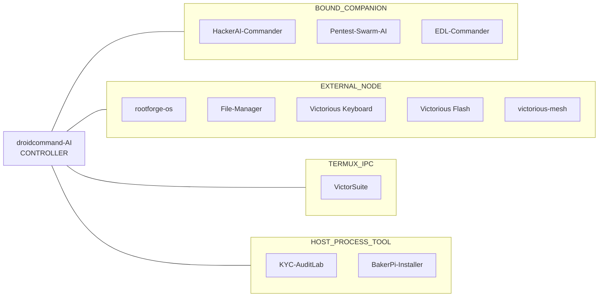

<div align="center">


<br />

[](https://github.com/Victorious93)
```text
>_ victorious-framework --whoami
```

**[About](#-about)** · **[Featured](#-featured-projects)** · **[More](#-more-projects)** · **[Architecture](#-how-the-fleet-connects)** · **[Stack](#-tech-stack)**

</div>

## ⚡ About

I'm Don, and I build the **Victorious Framework**: a set of Android, Linux and security tools that run as separate apps and connect to one hub app.

| | Focus | What it covers |
|:-:|:--|:--|
| 📱 | **Android & Termux tooling** | Root modules, boot-image work, Linux-on-Android, a keyboard and a file manager. |
| 🧠 | **AI agent hub** | [droidcommand-AI](https://github.com/Victorious93/droidcommand-AI) is the controller. The other apps stay standalone and connect to it. |
| 🔧 | **Recovery & installers** | Qualcomm EDL recovery, Linux ISO flashing, and Raspberry Pi Zero tool installs. |
| 🛡️ | **Security labs** | AI pentest assistants and a KYC test lab that only targets its own simulator. |

> [!NOTE]
> Most of these projects are in **early development**. Each repo's README says what has and hasn't been tested on real hardware.


## 🛰️ Featured projects

| Project | What it is |
|:--|:--|
| [**droidcommand-AI**](https://github.com/Victorious93/droidcommand-AI) <br/> `Kotlin` `Compose` | The hub of the fleet. You chat with it, and it calls tools under a security policy, runs “Forge” build workflows, and sends commands to member apps. The JVM engine is CI-tested. |
| [**rootforge-os**](https://github.com/Victorious93/rootforge-os) <br/> `Debian` `Termux` | A Debian live distro and Termux rootfs toolkit for Magisk/KernelSU module and boot-image work, with phone and desktop apps. |
| [**Victorious Keyboard**](https://github.com/Victorious93/Victorious-Keyboard) <br/> `Android` | An Android keyboard based on FlorisBoard, with an AES-256-GCM encrypted clipboard, a terminal key row, snippets and offline dictionary packs. Nothing leaves the device. |
| [**VictorSuite**](https://github.com/Victorious93/VictorSuite) <br/> `Termux` `proot` | A Termux/ZeroTermux-based Android Linux suite with proot containers, backup/restore, a plugin framework, X11 and automation. |
| [**VictorLink64**](https://github.com/Victorious93/VictorLink64) <br/> `Early beta` | Plays N64 (Mupen64Plus) and SNES (bsnes) games from your own files, with built-in chess and online, Wi-Fi or Bluetooth rooms. |
| [**HackerAI-Commander**](https://github.com/Victorious93/HackerAI-Commander) <br/> `Fork` `AIDL` | A fork of `hackerai-tech/hackerai`, the AI pentest assistant, plus a Kotlin/Compose Android companion that DroidCommand controls over AIDL. |


## 🧰 More projects

| Project | Status / scope | What it is |
|:--|:--|:--|
| [**Pentest-Swarm-AI**](https://github.com/Victorious93/Pentest-Swarm-AI) | AGPL fork | Armur-Ai's Go multi-agent pentest CLI, with an Android companion APK for the fleet. |
| [**BakerPi-Installer**](https://github.com/Victorious93/BakerPi-Installer) | FastAPI | Installs tools on a Raspberry Pi Zero 1.3 over USB OTG or SSH, from a browser or native UI. |
| [**victorious-mesh**](https://github.com/Victorious93/victorious-mesh) | tailscale-android fork | An Android VPN/mesh node for a self-hosted Headscale network. |
| [**KYC-AuditLab**](https://github.com/Victorious93/KYC-AuditLab) | Simulator only | IdentityShield, a local-first KYC security test lab that runs against its own bundled simulator. |
| [**Victorious Flash**](https://github.com/Victorious93/victorious-flash) | Tauri v2 | A desktop app that downloads Linux ISOs, checks them against checksums and flashes them to USB or SD. |
| [**EDL-Commander**](https://github.com/Victorious93/EDL-Commander) | ⚠️ Not hardware-tested | A safety-first Rust framework for Qualcomm EDL recovery, with a Sahara core and a simulator. |
| [**File-Manager**](https://github.com/Victorious93/File-Manager) | Standalone | An Android file manager with dual panes, tabs, and a copy/move queue with undo. |
| [**DreamOS-Victorious**](https://github.com/Victorious93/DreamOS-Victorious) | ⚠️ Not flashable | Phase 1 groundwork for pulling Android ROM source together: profile validator, reproducible source bundle, SHA-256 integrity check. |
| [**MT-Manager-VIP**](https://github.com/Victorious93/MT-Manager-VIP) *(FileForge)* | Skeleton (M0) | The skeleton of a clean-room Compose file manager. |


## 🟣 How the fleet connects

<details open>
<summary><b>Architecture diagram</b>: apps grouped by connection class</summary>
<br />



> [!IMPORTANT]
> This shows how the apps are *meant* to connect. Not every link is wired up yet. VictorLink64 isn't part of the fleet.

</details>


## 🔷 Tech stack

<p align="center">
  
  
  
  
  
  
  
  
</p>
<p align="center">
  
  
  
  
  
  
  
  
</p>

<details>
<summary><b>📊 GitHub stats</b> (live cards from third-party services; may not load in the GitHub mobile app)</summary>
<br />

<div align="center">
  
  
</div>

<div align="center">
  
</div>

</details>

<div align="center">

<sub><code>&gt;_</code> Victorious Framework: tools for Android, Linux, and agent-driven workflows.</sub>


</div>
