<div align="center">

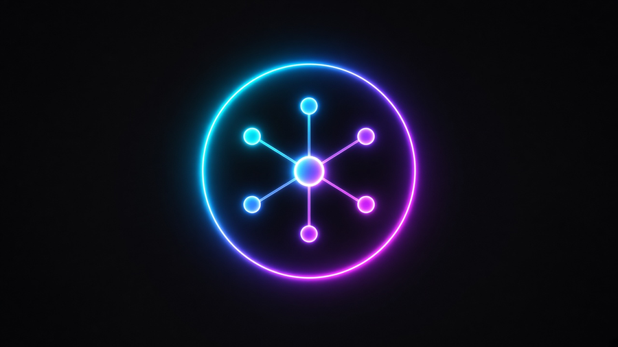

<p align="center">
  <a href="https://preview.victorious-framework.pages.dev/"></a>
  <a href="https://victorious-designs.pages.dev"></a>
  <!-- Instagram badge goes here, e.g.:
  <a href="https://instagram.com/HANDLE"></a>
  -->
</p>

<br />

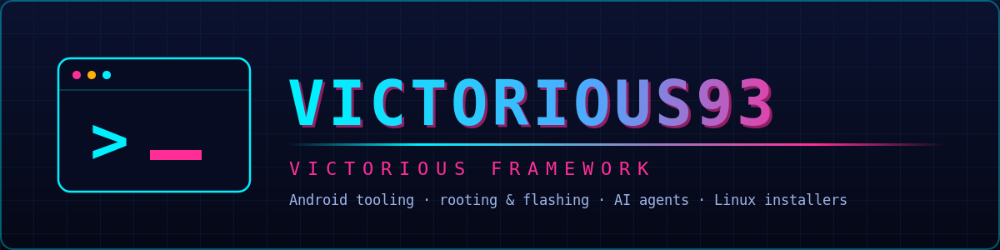

<br />

[](https://github.com/Victorious93)
```text
>_ victorious-framework --whoami
```

**[About](#-about)** · **[Fleet](#-victorious-fleet)** · **[More](#-more-apps--tools)** · **[Architecture](#-how-the-fleet-connects)** · **[Stack](#-tech-stack)**

</div>

## ⚡ About

I'm Don, and I build the **Victorious Framework**: a set of Android, Linux and security tools that run as separate apps and connect to one hub app.

| | Focus | What it covers |
|:-:|:--|:--|
| 📱 | **Android & Termux tooling** | Root modules, boot-image work, Linux-on-Android, a keyboard and a file manager. |
| 🧠 | **AI agent hub** | [droidcommand-AI](https://github.com/Victorious93/droidcommand-AI) is the controller. The other apps stay standalone and connect to it. |
| 🔧 | **Recovery & installers** | Qualcomm EDL recovery, Linux ISO flashing, and Raspberry Pi Zero tool installs. |
| 🛡️ | **Security labs** | AI pentest assistants and a KYC test lab that only targets its own simulator. |

> [!NOTE]
> Most of these projects are in **early development**. Each repo's README says what has and hasn't been tested on real hardware.


<p align="center"></p>

## 🛰️ Victorious fleet

Grouped by how each app connects to the hub. Package IDs are shown where the project defines one. Private repos are listed by name only.

**Controller / Hub**

###  droidcommand-AI

- **Repo:** [Victorious93/droidcommand-AI](https://github.com/Victorious93/droidcommand-AI)
- **Package id:** `ai.droidcommand.app`
- **Purpose:** The fleet controller/brain — remote command and orchestration of every app in the fleet.

### 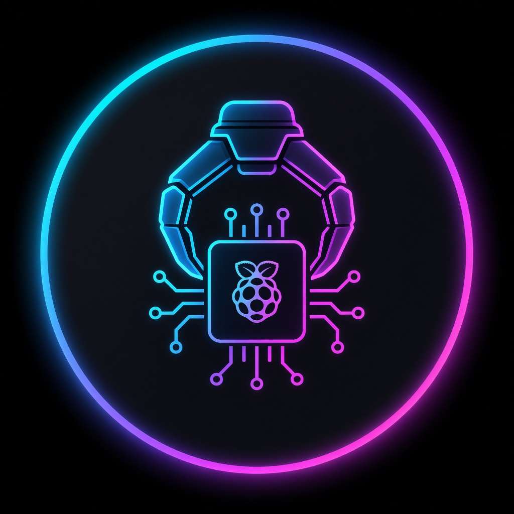 Pyra Claw

- **Repo:** pyra-claw *(private)*
- **Package id:** *(hub / hardware — not an Android package)*
- **Purpose:** Raspberry Pi 5 + ESP32 command hub that bridges the phone controller to physical devices.

###  VictorModem *(in planning)*

- **Repo:** victormodem *(private)*
- **Package id:** *(in planning / hardware — no confirmed package id yet)*
- **Purpose:** ESP32-S3 + cellular modem board that gives the fleet an independent second line.

**Bound Companions**

###  HackerAI-Commander

- **Repo:** [Victorious93/HackerAI-Commander](https://github.com/Victorious93/HackerAI-Commander)
- **Package id:** `ai.hackerai.companion`
- **Purpose:** Companion to the `hackeraiETC` fork — an AI hacking assistant.

### 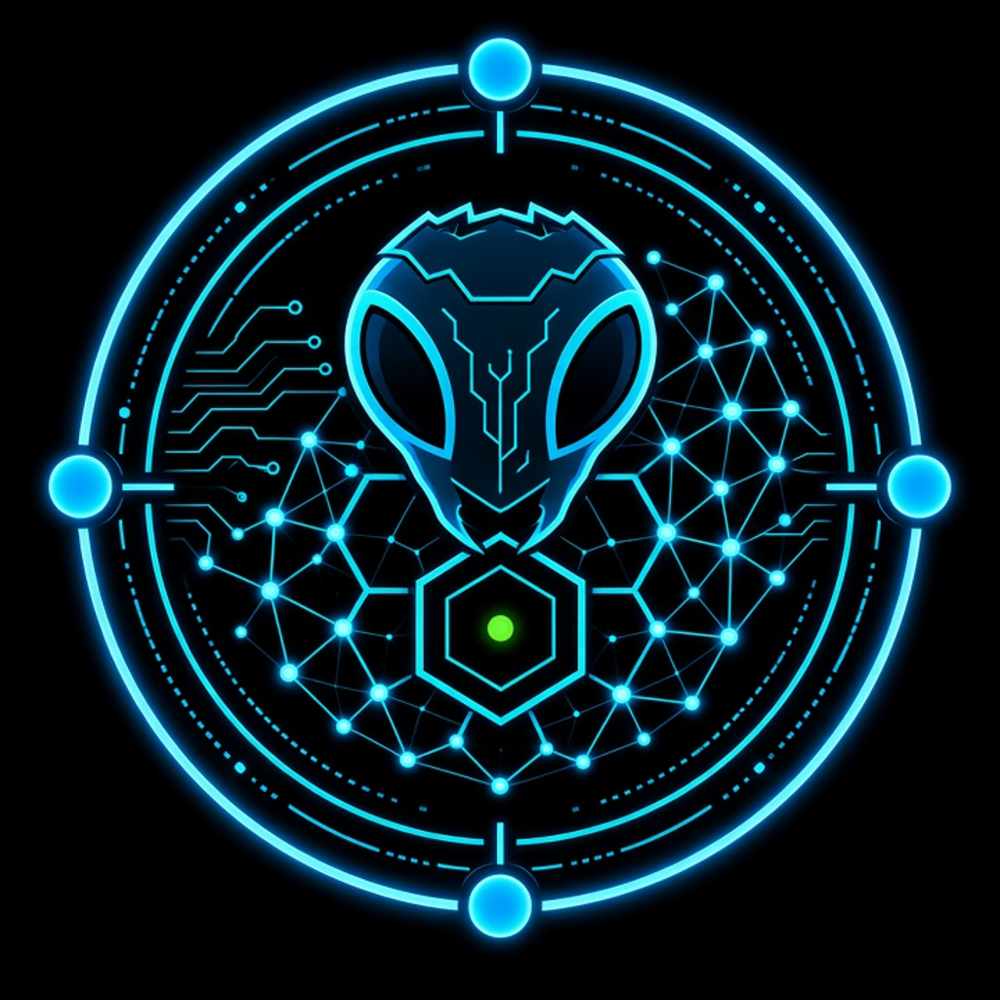 Pentest-Swarm-AI

- **Repo:** [Victorious93/Pentest-Swarm-AI](https://github.com/Victorious93/Pentest-Swarm-AI)
- **Package id:** `ai.pentestswarm.companion`
- **Purpose:** Multi-agent pentest swarm companion.

### 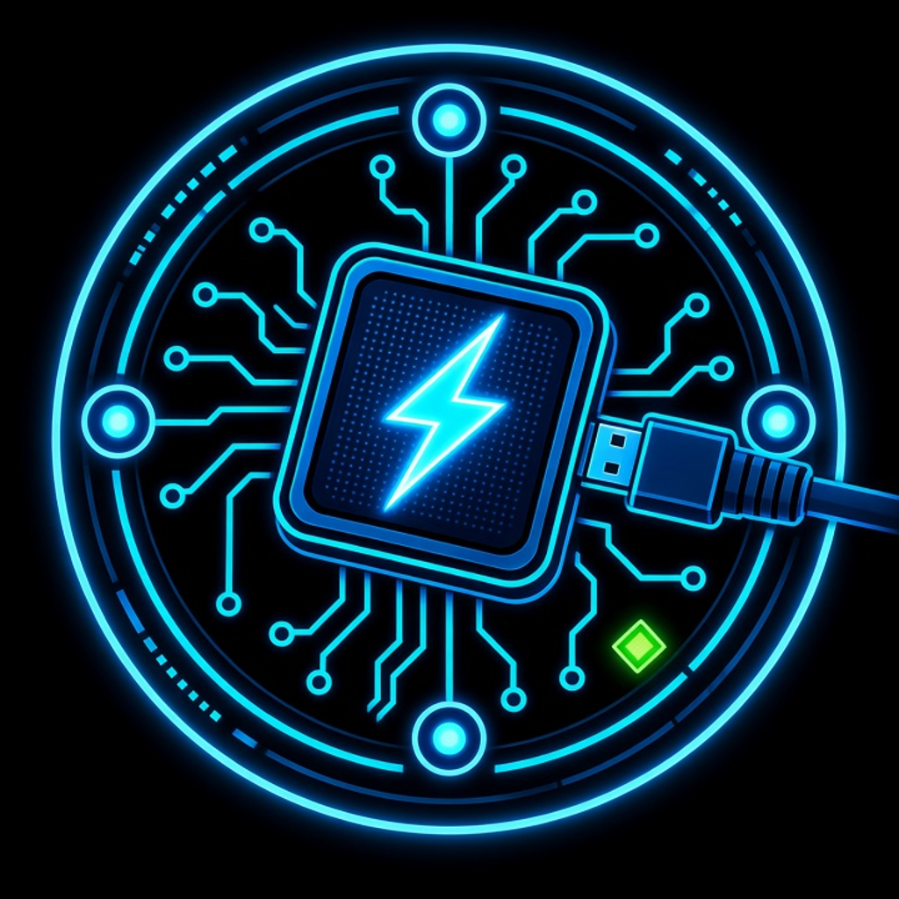 EDL-Commander

- **Repo:** [Victorious93/EDL-Commander](https://github.com/Victorious93/EDL-Commander)
- **Package id:** `ai.edlcommander.companion`
- **Purpose:** Safety-first Qualcomm EDL (Emergency Download mode) framework/tool companion.

**External Nodes**

### 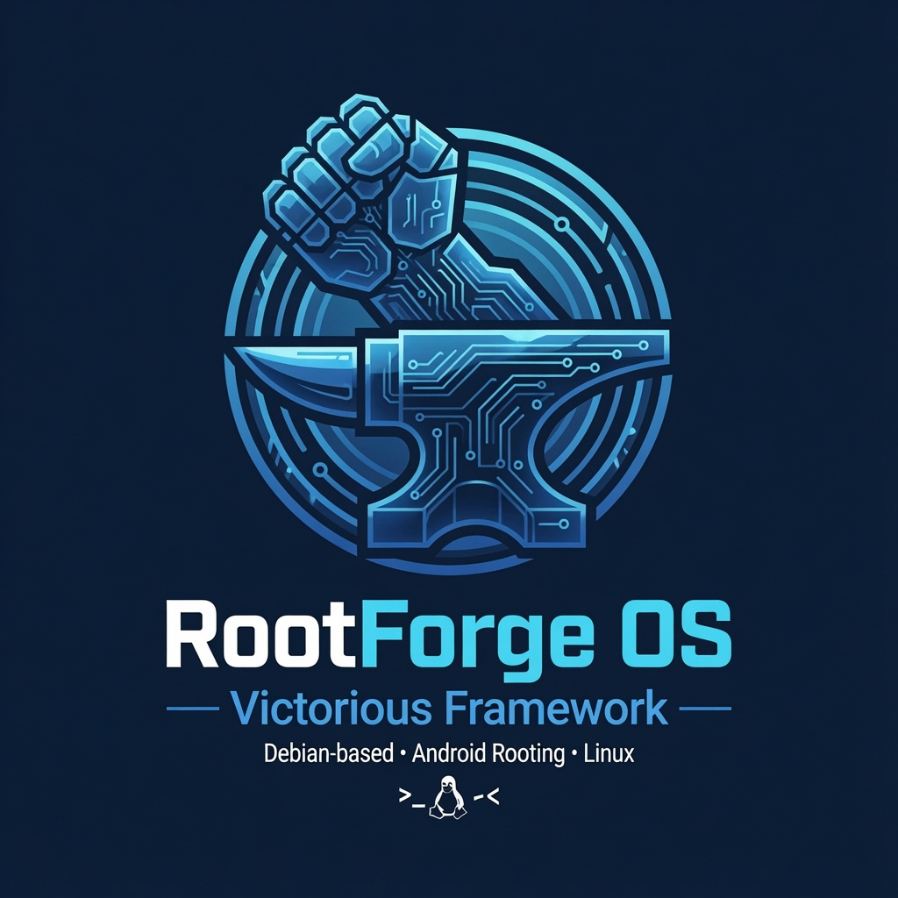 rootforge-os

- **Repo:** [Victorious93/rootforge-os](https://github.com/Victorious93/rootforge-os)
- **Package id:** `ai.rootforge.os`
- **Purpose:** Android rooting / root-management app.

###  File-Manager

- **Repo:** [Victorious93/File-Manager](https://github.com/Victorious93/File-Manager)
- **Package id:** `ai.victorious.filemanager` (debug: `ai.victorious.filemanager.debug`) *(rename in progress — repo still uses `ai.victorious.victorfiles`)*
- **Purpose:** Dual-pane power-user file manager aiming to beat MT Manager VIP.

#### Victorious-Keyboard *(logo pending)*

- **Repo:** [Victorious93/Victorious-Keyboard](https://github.com/Victorious93/Victorious-Keyboard)
- **Package id:** `com.victorious.keyboard` *(code namespace still `dev.patrickgold.florisboard` — rename queued)*
- **Purpose:** Custom Android keyboard with integrated media controls.

### 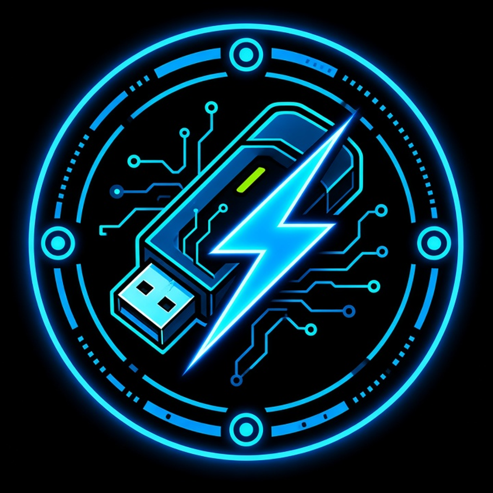 Victorious Flash (Distro Installer)

- **Repo:** [Victorious93/victorious-flash](https://github.com/Victorious93/victorious-flash) *(desktop app)*
- **Package id:** `com.victorious.flash.android` *(desktop app — not an APK)*
- **Purpose:** Desktop app to pick a Linux distro, download its official ISO, and write it to USB.

###  Victorious Mesh

- **Repo:** [Victorious93/victorious-mesh](https://github.com/Victorious93/victorious-mesh)
- **Package id:** `com.victorious.mesh`
- **Purpose:** Secure mesh-networking / VPN Android app.

###  Victorious Browser

- **Repo:** [Victorious93/victorious-browser](https://github.com/Victorious93/victorious-browser)
- **Package id:** `com.victorious.browser`
- **Purpose:** Fleet security / recon browser with web interception.

### 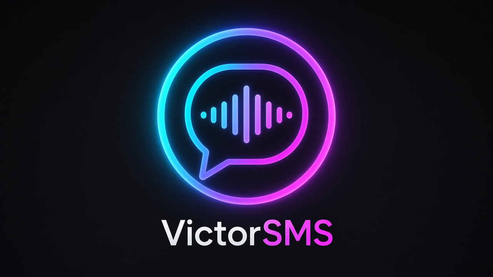 VictorSMS

- **Repo:** victorsms *(private)*
- **Package id:** `com.victorious.sms`
- **Purpose:** Universal messaging app (Matrix-based) with voice cloning and persona learning.

###  VictorLaunch

- **Repo:** victorlaunch *(private)*
- **Package id:** `com.victorious.launch`
- **Purpose:** Nova-class, Lawnchair-based fleet home-screen launcher.

### 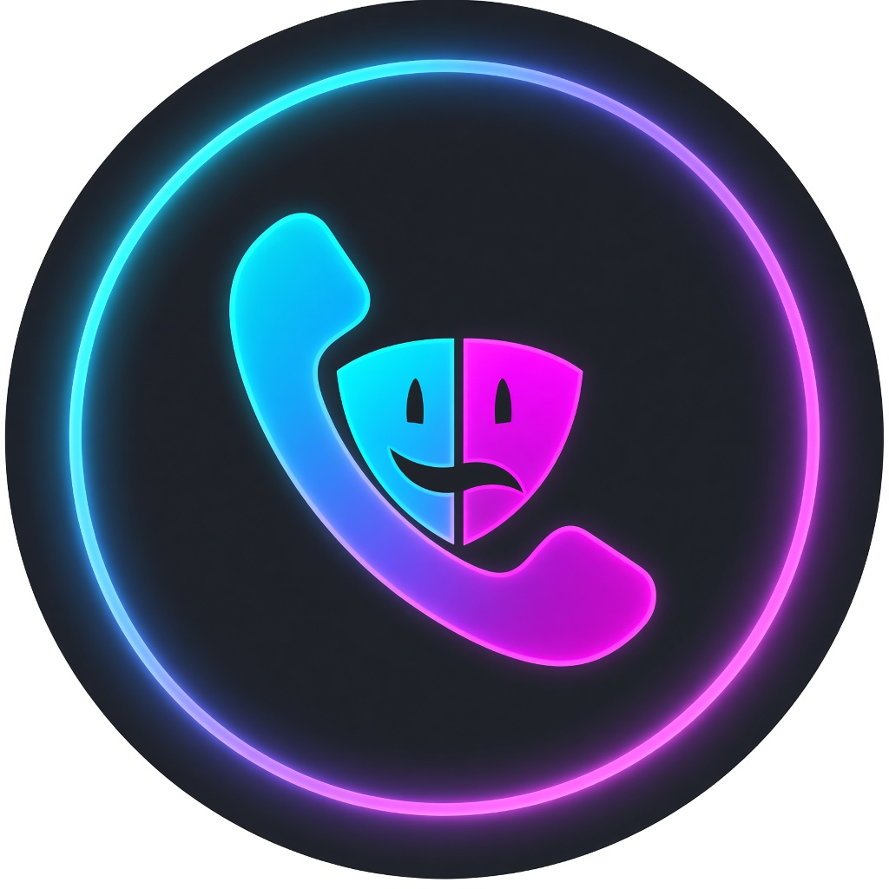 VictorSpoof

- **Repo:** victorspoof *(private)*
- **Package id:** `com.victorious.spoof`
- **Purpose:** Legal novelty / prank caller-ID app with strict compliance guardrails.

###  VictorLink64

- **Repo:** [Victorious93/VictorLink64](https://github.com/Victorious93/VictorLink64)
- **Package id:** `org.victoriousframework.victorlink64` *(Kotlin / Jetpack Compose; Android 9+)*
- **Purpose:** Multi-game emulator + play hub — play N64 and SNES games, built-in chess, and multiplayer with friends — in one Android app.

###  VictorCam

- **Repo:** VictorCam *(not public)*
- **Package id:** `com.victorious.cam`
- **Purpose:** OBS-style virtual camera APK.

**Termux / Host**

###  VictorSuite

- **Repo:** [Victorious93/VictorSuite](https://github.com/Victorious93/VictorSuite)
- **Package id:** `com.termux` (lineage; `TERMUX_IPC`)
- **Purpose:** Termux-based Android Linux suite — the fleet home for container-style workloads.

###  KYC-AuditLab / IdentityShield

- **Repo:** [Victorious93/KYC-AuditLab](https://github.com/Victorious93/KYC-AuditLab)
- **Package id:** `com.identityshield.companion`
- **Purpose:** Local KYC / identity audit lab.

### 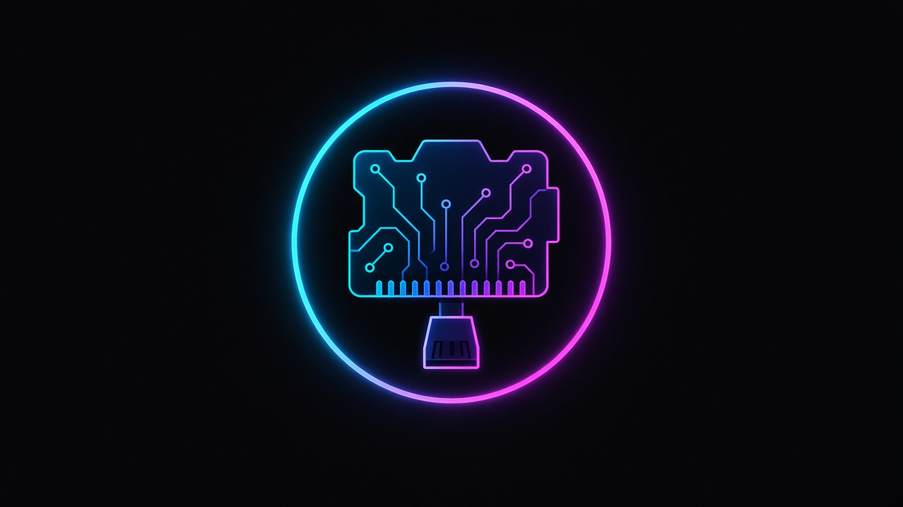 BakerPi-Installer

- **Repo:** [Victorious93/BakerPi-Installer](https://github.com/Victorious93/BakerPi-Installer)
- **Package id:** *(cross-platform tool — n/a)*
- **Purpose:** Cross-platform tool that installs/flashes in Raspberry Pi imaging style.

**Social / Marketplace Apps**

###  MatchVictorious

- **Repo:** [Victorious93/matchvictorious](https://github.com/Victorious93/matchvictorious)
- **Package id:** `com.victorious.match`
- **Purpose:** Dating app.

###  VictoryPed

- **Repo:** VictoryPed *(private)*
- **Package id:** `com.victorious.victoryped`
- **Purpose:** Social network and marketplace for bully breeders.


## 🧰 More apps & tools

Projects by Don that are not (yet) wired into the fleet connection model above.

| | Project | What it is |
|:--:|:--|:--|
| | [**DreamOS-Victorious**](https://github.com/Victorious93/DreamOS-Victorious) | Phase 1 groundwork for Android ROM source integration: profile validator, reproducible source bundle, SHA-256 integrity check (not flashable). |
| 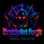 | [**droidpilot**](https://github.com/Victorious93/droidpilot) *(DroidPilot Forge)* | Stable Android device automation for AI agents via Accessibility Service + MCP — no ADB, no OCR; enhanced fork for agentic control. |


## 🟣 How the fleet connects

<details open>
<summary><b>Architecture diagram</b>: apps grouped by connection class</summary>
<br />

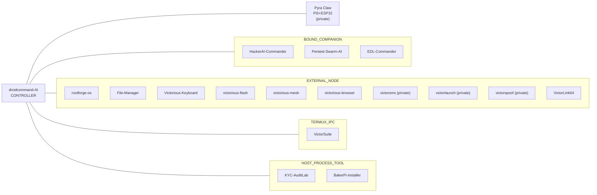

> [!IMPORTANT]
> This shows how the apps are *meant* to connect. Not every link is wired up yet. Private repos are listed by name only until they are public.

</details>


## 🔷 Tech stack

<p align="center">
  
  
  
  
  
  
  
  
</p>
<p align="center">
  
  
  
  
  
  
  
  
</p>

<details>
<summary><b>📊 GitHub stats</b> (live cards from third-party services; may not load in the GitHub mobile app)</summary>
<br />

<div align="center">
  
  
</div>

<div align="center">
  
</div>

</details>

<div align="center">

<sub><code>&gt;_</code> Victorious Framework: tools for Android, Linux, and agent-driven workflows.</sub>


</div>
