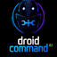
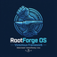
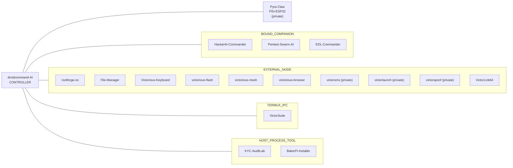

<div align="center">


<br />


<br />

[](https://github.com/Victorious93)
```text
>_ victorious-framework --whoami
```

**[About](#-about)** · **[Fleet](#-victorious-fleet)** · **[More](#-more-apps--tools)** · **[Architecture](#-how-the-fleet-connects)** · **[Stack](#-tech-stack)**

</div>

## ⚡ About

I'm Don, and I build the **Victorious Framework**: a set of Android, Linux and security tools that run as separate apps and connect to one hub app.

| | Focus | What it covers |
|:-:|:--|:--|
| 📱 | **Android & Termux tooling** | Root modules, boot-image work, Linux-on-Android, a keyboard and a file manager. |
| 🧠 | **AI agent hub** | [droidcommand-AI](https://github.com/Victorious93/droidcommand-AI) is the controller. The other apps stay standalone and connect to it. |
| 🔧 | **Recovery & installers** | Qualcomm EDL recovery, Linux ISO flashing, and Raspberry Pi Zero tool installs. |
| 🛡️ | **Security labs** | AI pentest assistants and a KYC test lab that only targets its own simulator. |

> [!NOTE]
> Most of these projects are in **early development**. Each repo's README says what has and hasn't been tested on real hardware.


## 🛰️ Victorious fleet

Grouped by how each app connects to the hub. Package IDs are shown where the project defines one.

### Controllers / hub

| | Project | Package | What it is |
|:--:|:--|:--|:--|
|  | [**droidcommand-AI**](https://github.com/Victorious93/droidcommand-AI) | `ai.droidcommand.app` | Android AI agent hub: JVM-tested tool engine, Forge builds, and fleet IPC to Termux/security companions. |
|  | **Pyra Claw** *(private, in development)* | — | Pi 5 + ESP32 command hub that bridges the phone controller to physical devices. |

### Bound companions

| | Project | Package | What it is |
|:--:|:--|:--|:--|
|  | [**HackerAI-Commander**](https://github.com/Victorious93/HackerAI-Commander) | `ai.hackerai.companion` | Fork of `hackerai-tech/hackerai` — AI pentest assistant with a Kotlin/Compose Android companion for the fleet. |
|  | [**Pentest-Swarm-AI**](https://github.com/Victorious93/Pentest-Swarm-AI) | `ai.pentestswarm.companion` | AGPL fork of Armur Pentest Swarm AI with an Android companion APK for the DroidCommand fleet. |
|  | [**EDL-Commander**](https://github.com/Victorious93/EDL-Commander) | `ai.edlcommander.companion` | Safety-first Rust framework for Qualcomm EDL recovery — Phase 1 Sahara core + simulator (no USB yet). |

### External nodes

| | Project | Package | What it is |
|:--:|:--|:--|:--|
|  | [**rootforge-os**](https://github.com/Victorious93/rootforge-os) | — | Debian live distro + Termux rootfs toolkit for Magisk/KernelSU module and boot-image work. |
|  | [**File-Manager**](https://github.com/Victorious93/File-Manager) *(VictorFiles)* | `ai.victorious.filemanager` | Standalone Android file manager with dual panes, tabs, copy/move queue with undo, and optional fleet stub. |
|  | [**Victorious-Keyboard**](https://github.com/Victorious93/Victorious-Keyboard) | — | Android IME based on FlorisBoard: encrypted clipboard, developer row, snippets, offline dictionary packs. |
|  | [**victorious-flash**](https://github.com/Victorious93/victorious-flash) | — | Download, verify and flash Linux ISOs to USB (Tauri v2). |
|  | [**victorious-mesh**](https://github.com/Victorious93/victorious-mesh) | — | Android VPN/mesh node for the droidcommand-AI fleet (self-hosted Headscale). |
|  | [**victorious-browser**](https://github.com/Victorious93/victorious-browser) | — | Fleet security/recon browser: WebView shell, on-device HTTP(S) inspection, and Messenger fleet bridge. |
|  | **victorsms** *(private, in development)* | `com.victorious.sms` | Fleet universal messaging APK (Matrix + bridges; EXTERNAL_NODE for droidcommand-AI). |
|  | **victorlaunch** *(private, in development)* | `com.victorious.launch` | Fleet-native Android home launcher (Lawnchair-based EXTERNAL_NODE for droidcommand-AI). |
|  | **victorspoof** *(private, in development)* | `com.victorious.spoof` | Fleet novelty/prank caller-ID Android app (owned-number pool + Twilio; EXTERNAL_NODE). |
|  | [**VictorLink64**](https://github.com/Victorious93/VictorLink64) | — | N64 (Mupen64Plus) and SNES (bsnes) from your own files, plus built-in chess and online / Wi-Fi / Bluetooth rooms. |

### Termux / host

| | Project | Package | What it is |
|:--:|:--|:--|:--|
|  | [**VictorSuite**](https://github.com/Victorious93/VictorSuite) | — | Termux-based Android Linux suite: proot containers, backup/restore, plugins, X11, and automation tools. |
|  | [**KYC-AuditLab**](https://github.com/Victorious93/KYC-AuditLab) | `com.identityshield.companion` | IdentityShield: local-first KYC security test lab against a bundled simulator (Phase 1). |
|  | [**BakerPi-Installer**](https://github.com/Victorious93/BakerPi-Installer) | — | Cross-platform tool installer for Pi Zero 1.3 — browser/native UI over USB OTG or SSH. |


## 🧰 More apps & tools

Projects by Don that are not (yet) wired into the fleet connection model above.

| | Project | What it is |
|:--:|:--|:--|
| | [**DreamOS-Victorious**](https://github.com/Victorious93/DreamOS-Victorious) | Phase 1 groundwork for Android ROM source integration: profile validator, reproducible source bundle, SHA-256 integrity check (not flashable). |
|  | [**droidpilot**](https://github.com/Victorious93/droidpilot) *(DroidPilot Forge)* | Stable Android device automation for AI agents via Accessibility Service + MCP — no ADB, no OCR; enhanced fork for agentic control. |


## 🟣 How the fleet connects

<details open>
<summary><b>Architecture diagram</b>: apps grouped by connection class</summary>
<br />



> [!IMPORTANT]
> This shows how the apps are *meant* to connect. Not every link is wired up yet. Private repos are listed by name only until they are public.

</details>


## 🔷 Tech stack

<p align="center">
  
  
  
  
  
  
  
  
</p>
<p align="center">
  
  
  
  
  
  
  
  
</p>

<details>
<summary><b>📊 GitHub stats</b> (live cards from third-party services; may not load in the GitHub mobile app)</summary>
<br />

<div align="center">
  
  
</div>

<div align="center">
  
</div>

</details>

<div align="center">

<sub><code>&gt;_</code> Victorious Framework: tools for Android, Linux, and agent-driven workflows.</sub>


</div>
