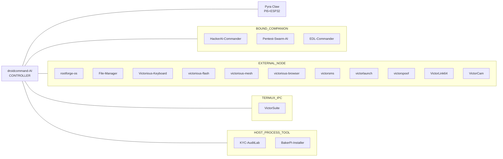

<div align="center">


<p>
  <a href="https://victorious-framework.pages.dev"></a>
  <a href="https://victorious-designs.pages.dev"></a>
  <a href="https://www.instagram.com/sudo.victorious00"></a>
</p>

<br />


<br />

[](https://github.com/Victorious93)

```text
>_ victorious-framework --whoami
```

**Android · Linux · AI agents · security tooling — separate apps, one fleet.**

**[About](#-about)** · **[Fleet](#-victorious-fleet)** · **[More](#-more-apps--tools)** · **[Architecture](#-how-the-fleet-connects)** · **[Stack](#-tech-stack)**

</div>

## ⚡ About

I'm Don, and I build the **Victorious Framework**: Android, Linux, and security tools that ship as separate apps and connect to one hub.

| | Focus | What it covers |
|:-:|:--|:--|
| 📱 | **Android & host tooling** | Root modules, boot-image work, Linux-on-Android, keyboard, file manager |
| 🧠 | **AI agent hub** | [droidcommand-AI](https://github.com/Victorious93/droidcommand-AI) — controller; other apps stay standalone |
| 🔧 | **Recovery & installers** | Qualcomm EDL recovery, Linux ISO flashing, Raspberry Pi tool installs |
| 🛡️ | **Security labs** | AI pentest assistants and a KYC test lab that only targets its own simulator |

> [!NOTE]
> Most projects are in **early development**. Each repo README states what has (and has not) been tested on real hardware.

Monorepo pointers: **[Victorious93/victorious-fleet](https://github.com/Victorious93/victorious-fleet)** · Site: **[victorious-framework.pages.dev](https://victorious-framework.pages.dev)**


<p align="center"></p>

## 🛰️ Victorious fleet

Grouped by how each app connects to the hub. Package IDs come from each project’s build files where defined. Private repos are named only (no public link).

### Controller / Hub

| | App | Package | Purpose |
|:-:|:--|:--|:--|
|  | [**droidcommand-AI**](https://github.com/Victorious93/droidcommand-AI) | `ai.droidcommand.app` | Fleet controller — remote command & orchestration |
|  | [**Pyra Claw**](https://github.com/Victorious93/pyra-claw) | `com.victorious.pyraclaw` *(companion)* / hardware hub | Pi 5 + ESP32 command hub |
|  | VictorModem *(private)* | hardware — no Android package yet | ESP32-S3 + cellular second line |

### Bound Companions

| | App | Package | Purpose |
|:-:|:--|:--|:--|
|  | [**HackerAI-Commander**](https://github.com/Victorious93/HackerAI-Commander) | `ai.hackerai.companion` | Companion to the hackeraiETC fork |
|  | [**Pentest-Swarm-AI**](https://github.com/Victorious93/Pentest-Swarm-AI) | `ai.pentestswarm.companion` | Multi-agent pentest swarm companion |
|  | [**EDL-Commander**](https://github.com/Victorious93/EDL-Commander) | `ai.edlcommander.companion` | Safety-first Qualcomm EDL companion |

### External Nodes

| | App | Package | Purpose |
|:-:|:--|:--|:--|
|  | [**rootforge-os**](https://github.com/Victorious93/rootforge-os) | `ai.rootforge.os` | Rooting / root-management |
|  | [**File-Manager**](https://github.com/Victorious93/File-Manager) | `ai.victorious.victorfiles` *(rename → `filemanager` planned)* | Dual-pane power-user file manager |
|  | [**Victorious-Keyboard**](https://github.com/Victorious93/Victorious-Keyboard) | `com.victorious.keyboard` | Custom keyboard + media controls |
|  | [**Victorious Flash**](https://github.com/Victorious93/victorious-flash) | `com.victorious.flash.android` | Desktop Linux ISO → USB installer |
|  | [**Victorious Mesh**](https://github.com/Victorious93/victorious-mesh) | `com.victorious.mesh` | Secure mesh / VPN |
|  | [**Victorious Browser**](https://github.com/Victorious93/victorious-browser) | `com.victorious.browser` | Security / recon browser |
|  | [**VictorSMS**](https://github.com/Victorious93/victorsms) | `com.victorious.sms` | Matrix messaging + persona tools |
|  | [**VictorLaunch**](https://github.com/Victorious93/victorlaunch) | `com.victorious.launch` | Fleet home-screen launcher |
|  | [**VictorSpoof**](https://github.com/Victorious93/victorspoof) | `com.victorious.spoof` | Novelty caller-ID with compliance guards |
|  | [**VictorLink64**](https://github.com/Victorious93/VictorLink64) | `org.victoriousframework.victorlink64` | Multi-game emulator hub *(not remote fleet)* |
|  | [**VictorCam**](https://github.com/Victorious93/victorcam) | `com.victorious.cam` | OBS-style virtual camera *(repo scaffolding)* |

### Host & Shell Tools

| | App | Package | Purpose |
|:-:|:--|:--|:--|
|  | [**VictorSuite**](https://github.com/Victorious93/VictorSuite) | `com.termux` *(TERMUX_IPC lineage)* | Android Linux environment suite for the fleet |
|  | [**KYC-AuditLab**](https://github.com/Victorious93/KYC-AuditLab) | `com.identityshield.companion` | Local KYC / identity audit lab |
|  | [**BakerPi-Installer**](https://github.com/Victorious93/BakerPi-Installer) | n/a (host tool) | Pi Zero tool installer (PC / on-device) |
| | [**DreamOS-Victorious**](https://github.com/Victorious93/DreamOS-Victorious) | n/a | Phase 1 ROM source integration foundation |

### Social / Marketplace

| | App | Package | Purpose |
|:-:|:--|:--|:--|
|  | [**MatchVictorious**](https://github.com/Victorious93/matchvictorious) | `com.victorious.match` | Dating hub |
|  | VictoryPed *(private)* | `com.victorious.victoryped` | Social / marketplace for bully breeders |

### Games

| | App | Package | Purpose |
|:-:|:--|:--|:--|
|  | VictorOps Zombies *(private)* | `com.victorious.zombie` | Wave-survival zombies game (libGDX + Kotlin) |


## 🧰 More apps & tools

Projects by Don that are not (yet) wired into the fleet connection model above.

| | Project | What it is |
|:--:|:--|:--|
|  | [**droidpilot**](https://github.com/Victorious93/droidpilot) *(DroidPilot Forge)* | Stable Android device automation for AI agents via Accessibility Service + MCP — no ADB, no OCR |


## 🟣 How the fleet connects

<details open>
<summary><b>Architecture diagram</b>: apps grouped by connection class</summary>
<br />



> [!IMPORTANT]
> This shows how the apps are *meant* to connect. Not every link is wired yet. Private repos stay unlinked until public.

</details>


## 🔷 Tech stack

<p align="center">
  
  
  
  
  
  
  
  
</p>
<p align="center">
  
  
  
  
  
  
  
</p>

<details>
<summary><b>📊 GitHub stats</b> (live cards from third-party services; may not load in the GitHub mobile app)</summary>
<br />

<div align="center">
  
  
</div>

<div align="center">
  
</div>

</details>

<div align="center">

<sub><code>&gt;_</code> Victorious Framework: tools for Android, Linux, and agent-driven workflows.</sub>


</div>
